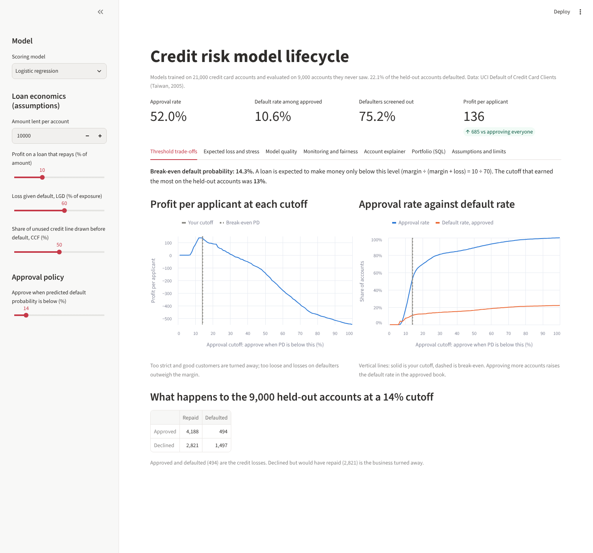

# Credit risk model lifecycle

Builds a credit card default model and then does what a bank does with one: sets an approval policy, measures expected loss, stress-tests it, monitors it for drift, tests outcomes across demographic groups, explains individual decisions, and writes up the validation.



## What it does

| Stage | What the project does | Where |
|---|---|---|
| Data controls | Eight checks on the raw file before modelling | `creditrisk/quality.py` |
| SQL layer | Loads accounts into DuckDB; model inputs and portfolio cuts written in SQL | `sql/`, `creditrisk/warehouse.py` |
| Model | Logistic regression (champion), with kNN, a raw-column baseline and a gradient-boosting challenger | `creditrisk/model.py`, `features.py` |
| Validation metrics | AUC, KS, ROC, calibration, written in NumPy | `creditrisk/metrics.py` |
| Approval policy | Approval rate, default rate and profit at every cutoff; break-even PD | `creditrisk/threshold.py` |
| Scorecard | PD converted to a credit score and risk grade | `creditrisk/scorecard.py` |
| Expected loss | PD x LGD x EAD per account, with credit-line drawdown | `creditrisk/loss.py` |
| Stress testing | Adverse and severe behaviour shocks and a credit-line cut, re-scored | `creditrisk/stress.py` |
| Monitoring | Population stability index for the score and each input | `creditrisk/monitoring.py` |
| Outcome testing | Approval rates and adverse impact ratios by group | `creditrisk/fairness.py` |
| Reason codes | Exact per-account explanation of a decline | `creditrisk/explain.py` |
| Reporting | Auto-generated validation report; CSV extracts for Tableau or Power BI | `scripts/`, `docs/`, `exports/` |

## Headline results (9,000 held-out accounts)

| Model | Test AUC | KS | Best profit per applicant |
|---|---|---|---|
| Logistic regression (champion) | 0.757 | 0.401 | 137 |
| Logistic regression, raw columns | 0.713 | 0.376 | 59 |
| k-nearest neighbours, k = 50 | 0.766 | 0.408 | 153 |
| Gradient boosting (challenger) | 0.778 | 0.420 | 174 |

- **Policy.** A 14% PD cutoff approves 52.0% of accounts with a 10.6% default rate among approved accounts, against 22.1% overall.
- **Price of interpretability.** The challenger earns 27% more profit per applicant than the explainable champion.
- **Expected loss.** 106.2M expected against 110.4M on the accounts that defaulted (3.8% under), on 989M of exposure.
- **Stress.** Expected loss rises 22% in the adverse scenario and 81% in the severe one; the severe scenario cuts the approval rate from 52% to 15%.
- **Credit line cut.** Cutting every limit by 20% lowers expected loss 7.7%, but the model then scores the same customers as riskier (average PD 22.0% to 23.1%) because a lower limit means higher utilization.
- **Feature tested and rejected.** A six-month balance-trend input left held-out AUC unchanged at 0.757, so it is not in the model (`scripts/evaluate_candidate_feature.py`).
- **Monitoring.** In the adverse scenario the score PSI stays "stable" (0.06) while losses rise 22%; input-level PSI catches it.
- **Outcome testing.** One group (high-school education) falls just under the 0.80 screening ratio although education is not a model input.

Full detail: [docs/model_validation_report.md](docs/model_validation_report.md).

## How to run it

```bash
git clone https://github.com/Victori8bug/credit-default.git
cd credit-default
python -m venv .venv
source .venv/bin/activate        # Windows: .venv\Scripts\activate
pip install -r requirements.txt

streamlit run app.py                       # the app, at http://localhost:8501
pytest                                     # 39 tests
python scripts/build_exports.py            # refresh exports/*.csv
python scripts/build_validation_report.py  # refresh docs/model_validation_report.md
python scripts/evaluate_candidate_feature.py  # AUC with and without a candidate input
```

Developed and tested on Python 3.13. The data file ships with the repo; no download, account or API key is needed.

## Using the extracts in Tableau or Power BI

`exports/accounts_scored.csv` has one row per held-out account: PD, credit score, risk grade, decision, exposure, expected loss, actual outcome and demographic labels. `threshold_sweep.csv` and `stress_scenarios.csv` hold the policy curve and scenario results. Connect any of them as a text-file data source. No dashboard is included in this repo yet.

## The math

**Logistic regression.** `log(PD / (1 - PD)) = b0 + b1*x1 + ...` on standardised inputs. Each term is that input's push on the log-odds, which is why reason codes are exact.

**AUC.** Probability a random defaulter is scored riskier than a random good payer. Hand example: defaulters at 0.35 and 0.80, good payers at 0.10 and 0.40; the defaulter ranks higher in 3 of 4 pairs, so AUC = 0.75.

**Break-even PD.** A loan earning `margin` if repaid and losing `lgd` if not breaks even at `PD = margin / (margin + lgd)`. With 10% and 60%: 14.3%.

**Credit score.** `score = offset + factor x ln(odds of repaying)`, `factor = PDO / ln 2`. With 600 points at 50:1 odds and 20 points to double the odds: factor 28.85, offset 487.12.

**Expected loss.** `EL = PD x LGD x EAD`, `EAD = balance + CCF x unused limit`. Hand example: balance 40,000 on a 100,000 line with CCF 50% gives EAD 70,000; at PD 10% and LGD 60%, EL = 4,200.

**PSI.** `sum of (actual% - expected%) x ln(actual% / expected%)` over bins. Hand example: a 50/50 split moving to 60/40 gives 0.0405.

**Adverse impact ratio.** Group approval rate divided by the highest group's approval rate. 40% against 50% gives 0.80.

Every hand example above is a test in `tests/`.

## Data

UCI Machine Learning Repository, *Default of Credit Card Clients* (dataset 350). I-Cheng Yeh and Che-hui Lien (2009), *Expert Systems with Applications* 36(2). 30,000 Taiwanese credit card accounts, April to September 2005; 6,636 (22.1%) defaulted the following month.

## Assumptions and limits

- Existing cardholders with six months of history: a behavioural score, not a new-applicant score.
- One market during a card-debt crisis. The 22% default rate is far above a normal portfolio.
- LGD (60%), CCF (50%), margin (10%), equal loan size on the threshold tab, and the risk-grade bands are assumptions.
- Stress scenarios shock model inputs; they are not tied to economic forecasts.
- One 70/30 random split with a fixed seed. No out-of-time test, because the data has a single observation date.
- The profit-maximising cutoff is chosen on the same held-out accounts it is reported on.
- PSI bands and the 0.80 ratio are screening conventions, not statistical tests or legal standards.
- The model scores "paid in full this month" as riskier than revolving, an open validation finding.

## Next steps

- A larger loan-level dataset with origination dates (for example LendingClub or Fannie Mae) to allow out-of-time validation and vintage analysis
- Weight-of-evidence binning to resolve the repayment-code finding
- Link stress scenarios to economic variables
- A Tableau Public dashboard on the extracts
